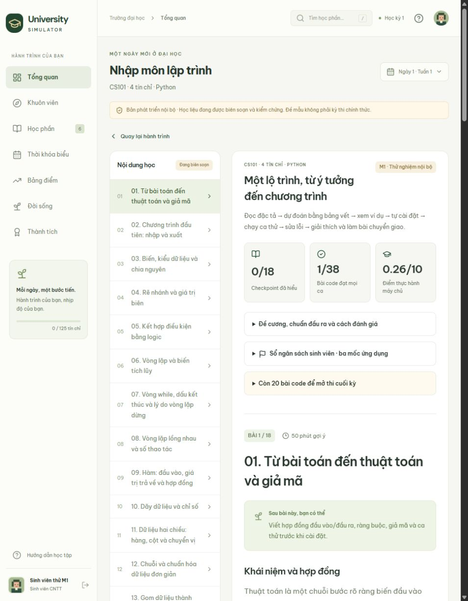

# M1 — Kiểm chứng học liệu và đánh giá nhập môn

Trạng thái ngày 01/11/2026: bộ nhập môn đang phục vụ thử nghiệm nội bộ. Bài giảng, bài luyện, gợi ý và lời giải được biên soạn sẵn; không dùng trợ giảng AI trong lúc học. Kết quả kỹ thuật dưới đây không thay thế duyệt học thuật độc lập, thử với người mới hoặc xác nhận hoàn thành phase 1.

## Phạm vi học và đánh giá

- Hai đường C++/Python dùng cùng sáu chuẩn đầu ra, 18 chủ đề và cùng hợp đồng bài thực hành.
- Có 76 chương trình tham chiếu cho bài luyện, bài chuyển giao và ba mốc sổ ngân sách. Mọi bài của hai đường có hoạt động thực hành thực thi được.
- Giữa kỳ, cuối kỳ và thi lại có ba định nghĩa/phiên bản riêng, mỗi đề 12 câu kiến thức và một bài lập trình. Câu kiến thức chiếm 50% điểm đề, bài lập trình chiếm 50%.
- Giữa kỳ báo tiêu chí code đạt khi ít nhất 70% kiểm thử đúng; điểm giữa kỳ vẫn là tổng có trọng số và không tự tạo thêm quy tắc trượt môn. Cuối kỳ và thi lại yêu cầu ít nhất 80% kiểm thử code như điều kiện qua môn bắt buộc. Một đáp án trắc nghiệm tốt không thay thế điều kiện code cuối kỳ.
- Đề giữa kỳ chỉ dùng kiến thức nửa đầu: hợp đồng, nhập xuất, kiểu, rẽ nhánh, logic, vòng lặp và hàm. Đề cuối kỳ/thi lại bổ sung dãy, tìm kiếm, sắp xếp, kiểm thử và câu hỏi về chuỗi/ma trận.
- Đề thi lại dùng tác vụ khác với đề cuối kỳ đầu tiên. Máy chủ chọn theo số lượt và đóng băng phiên bản trong attempt đã bắt đầu.

| Đánh giá công khai nội bộ | Bài code | Các lớp ca thử |
| --- | --- | --- |
| Giữa kỳ | Đối soát phiếu chi: cộng khoản không âm, đếm phiếu bị loại | Rỗng, khoản 0, số âm, nhiều dòng, tổng vượt int32 |
| Cuối kỳ | Đếm target và sắp xếp toàn bộ dãy tăng dần | Rỗng, một phần tử, trùng, số âm, dữ liệu lớn, thứ tự sẵn có |
| Thi lại cuối kỳ | Giữ giá trị từ ngưỡng trở lên rồi sắp giảm dần | Đúng biên ngưỡng, không có phần tử, trùng, số âm và thứ tự ngược |

Các bài sắp xếp giới hạn 500 phần tử ở miền ±10^12 để cả kết quả hợp lệ lớn nhất vẫn nằm trong giới hạn đầu ra 8 KiB của bộ chấm.

Đây là **ngân hàng phát triển công khai**: đáp án mẫu và các ca kiểm tra có trong repository. Chúng không phải đề thi riêng hoặc một cơ chế chứng minh người chơi tự viết mã. Production tiếp tục từ chối ngân hàng này và nội dung chưa được duyệt.

## Lệnh kiểm chứng lời giải do tác giả cung cấp

```powershell
npm run verify:intro
```

CLI chỉ chạy những chuỗi mã tham chiếu và biến thể sai do tác giả khai báo trong các module của repository. Không nhận đường dẫn mã người học, ID bài nộp, mã tùy ý hoặc dữ liệu sinh viên. Không được gọi CLI này từ API/worker để chấm bài người chơi; bài nộp vẫn phải qua môi trường thực thi cô lập.

- Windows: Python 3 và `g++` C++20 trong WSL Ubuntu.
- Linux: Python 3 và `g++` C++20 trên PATH.
- Mã nguồn sinh ra, hash, kết quả và báo cáo được lưu trong `.data/intro-verification/`, đã bị Git bỏ qua. Không đọc cơ sở dữ liệu người học.
- Mỗi chương trình có giới hạn thời gian và dung lượng output; mã tham chiếu được kiểm tra hash trước khi chạy. Các tiến trình kiểm chứng chỉ nhận tập biến môi trường tối thiểu, không nhận khóa dịch vụ ứng dụng.

## Kết quả đã chạy thực tế

| Hạng mục | Kết quả |
| --- | --- |
| Python | Python 3.13.11 trên Windows |
| C++ | g++ Ubuntu 13.3.0, chuẩn C++20, qua WSL |
| Lời giải đúng | **82/82 đạt**: 76 bài luyện và 6 biến thể đề theo ngôn ngữ |
| Lời giải sai có chủ đích | **10/10 bị bộ ca thử phát hiện** |
| Số lần thực thi ca kiểm tra | **466** |
| Lỗi biên dịch hoặc sai kết quả ở lời giải đúng | **0** |

Các biến thể sai gồm cộng nhầm phiếu âm, loại nhầm khoản 0, sắp sai chiều và bỏ trường hợp đúng bằng ngưỡng. Chúng được biên dịch/chạy thật; lỗi cú pháp không được tính là đã phát hiện một thuật toán sai hợp lệ.

Kiểm thử tự động bổ sung kiểm tra độ phủ chủ đề, ánh xạ hai ngôn ngữ, tỷ trọng và điều kiện code, biến thể thi lại, giới hạn output, dữ liệu trùng, quyền riêng của serializer và việc production từ chối ngân hàng phát triển.

## Kiểm chứng trên server Linux riêng tư

Ngày 01/11/2026, bản thử tại `/srv/university-simulator` được truy cập qua SSH tunnel, với Node 24.14 và Docker Linux. API/frontend chỉ lắng nghe loopback; chưa đưa vào routing công khai.

- **9/9 kiểm thử Docker thật đạt**: C++, Python, JavaScript, SQLite; phát hiện kết quả sai, lỗi biên dịch, lỗi khi chạy; giới hạn thời gian/đầu ra; không có mạng ra ngoài, socket Docker hay root filesystem có thể ghi; UID/capability và hạn mức bộ nhớ/PID đúng; không trả đáp án riêng; container được dọn và hàng đợi SQLite áp dụng kết quả thật.
- `npm run test:m1-journey`: hai sinh viên giả, mỗi đường 18 checkpoint và **38 bài code**, tổng cộng **296 ca của bài luyện** qua HTTP API và Docker. Mỗi đường thi giữa kỳ, nộp code sai ở cuối kỳ rồi thi lại bằng đề khác. Kết quả giữa kỳ 10, cuối kỳ cố ý sai code 5 và môn chưa đạt, thi lại 10 và môn đạt 10; cả ba lượt được giữ trong lịch sử.
- Luồng hai người chạy song song với tối đa hai job mất **296 giây**. Đây là kiểm tra chức năng bằng lời giải tác giả, không phải benchmark năng lực người mới hoặc năng lực phục vụ công khai.
- Kiểm tra UI thật qua tunnel: tạo hồ sơ, đăng ký 16 tín chỉ, mã sai bị 0/3, sửa đúng đạt 3/3; tải lại vẫn khôi phục mã và kết quả. Điểm thực hành của một bài đúng là 0,26/10 trên đủ 38 bài.
- Đã tạo snapshot SQLite nhất quán bằng `VACUUM INTO`, kiểm tra integrity và quyền 0600; dữ liệu nằm ngoài thư mục release.
- Sau khi chuyển sang release `20261101-93314b4` và restart API, đăng nhập lại hai hồ sơ giả vẫn đọc được đúng sinh viên, đủ 38 bài code và kết quả đạt môn. Snapshot sau đó được khôi phục vào thư mục dữ liệu riêng, mở bằng API tạm tại một cổng loopback khác và vượt cùng kiểm tra. API tạm đã được dừng; database đang phục vụ không bị ghi đè.



## Giới hạn của bằng chứng

Kiểm chứng này xác nhận các lời giải tham chiếu cho kết quả mong đợi trên bộ dữ liệu đã khai báo và các lỗi mẫu bị phát hiện. Nó không chứng minh mọi thuật toán tương đương, chất lượng thiết kế, cách tách hàm, độ sâu giải thích, năng lực học của người mới hay khả năng chịu tải của Docker/E2B.

`npm run test:load` dùng ngân hàng trắc nghiệm công khai **tổng hợp riêng cho benchmark API**, không dùng ngân hàng code M1. Báo cáo đó không được diễn giải thành kiểm chứng tải thực thi mã hoặc hoàn thành M1. Luồng học–luyện–thi với mã người chơi phải được kiểm tra riêng qua adapter cô lập, sau đó tiếp tục thử với người học thật và duyệt học thuật.
