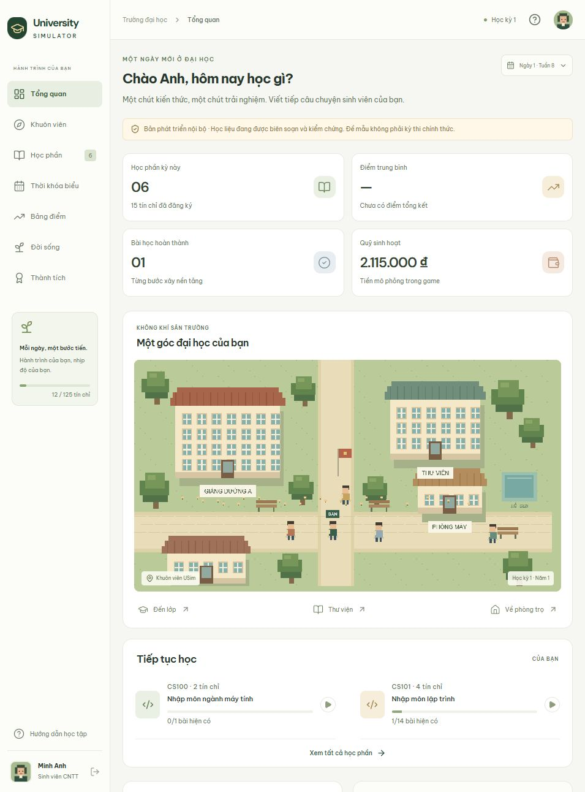

# Kiểm chứng bản phát triển nội bộ

Ngày kiểm tra: **01/11/2026**, giờ Việt Nam. Báo cáo nền dưới đây thuộc commit `b520a7a`; kết quả mới cho M1 và bản chạy server nằm trong [kiểm chứng M1](M1-VERIFICATION.md). Đây chưa phải nghiệm thu phát hành phase 1.

## Kiểm tra tự động

- `npm run check`: TypeScript toàn workspace, **172 kiểm thử trong 12 file**, và build frontend/API/worker đều đạt.
- Kiểm thử học vụ bao phủ hai đường tốt nghiệp 125/126 tín chỉ, tiên quyết, lịch lớp, miễn tiếng Anh không tăng GPA, tiếng Anh chuyên ngành bắt buộc, học lại và tính điểm.
- Kiểm thử backend bao phủ quyền sở hữu, hạn thi theo máy chủ, lưu/nộp lặp, đóng băng nguồn đã nhận, hàng đợi và phục hồi, tiêu chí code bắt buộc, quản trị MFA và nhật ký.
- Bộ lưu bài frontend kiểm tra gửi tuần tự, sửa bài trong khi chờ xác nhận, mất mạng, thử lại và hết giờ. Tin học văn phòng kiểm tra công thức, thay đổi dữ liệu đầu vào, chu trình, giới hạn và nội dung tài liệu/trình chiếu.
- Các ví dụ tham chiếu của 14 bài nhập môn Python đã được chạy trong kiểm thử. Ví dụ C++ chưa được biên dịch kiểm chứng trong môi trường này.
- `npm audit`: không phát hiện lỗ hổng dependency tại thời điểm kiểm tra. Kết quả này không thay thế kiểm toán bảo mật ứng dụng.
- Dev server trả HTTP 403 khi yêu cầu `.env` hoặc nguồn backend qua `/@fs`, kể cả alias workspace trong `node_modules`; ứng dụng vẫn trả HTTP 200 và tải lại giao diện được. Chỉ cho phép thư mục frontend và hai package công khai, lắng nghe trên loopback.
- Kiểm thử hồi quy bảo đảm header xác thực giả không nâng hạn mức; lưu lượng đã xác thực chung IP không tiêu quota đăng nhập ẩn danh; health vẫn hoạt động khi hết quota. Manifest bên ngoài không thể bật production khi học liệu thật trong bản build còn nháp.

## Thử tải API cục bộ

`npm run test:load` tự mở API và SQLite riêng, không dùng dữ liệu hồ sơ đang chơi. Kịch bản chạy 100 người học đồng thời, cả hai ngành và hai đường nhập môn: tạo hồ sơ, đăng ký, tiến tuần, lưu/nộp thi giữa kỳ, đọc tiến độ và hoạt động đời sống.

| Chỉ số | Kết quả |
|---|---:|
| Người học hoàn thành | 100/100 |
| Tổng yêu cầu | 1.500 |
| Thời gian | 2,58 giây |
| p95 yêu cầu | 204,7 ms |
| Lỗi HTTP / lỗi luồng | 0 / 0 |

Đây là kết quả trên máy phát triển với SQLite. Chưa xác minh năng lực PostgreSQL/Supabase, Redis, E2B, Render, 10 job thực thi đồng thời, chi phí hoặc tải production. Báo cáo JSON có thể tái tạo trong `.data/load-*/report.json` và không được đưa lên Git.

## Kiểm tra bằng giao diện thật

Dùng hồ sơ giả **Minh Anh**, ngành CNTT, đường Python:

1. Đăng nhập phát triển, tạo sinh viên, xếp lớp tiếng Anh: miễn 12 tín chỉ, GPA chưa có.
2. Đăng ký theo cố vấn: 6 môn, 15 tín chỉ, học phí ghi vào sổ giao dịch.
3. Hoàn thành checkpoint nhập môn; tải lại vẫn giữ tiến độ phía máy chủ.
4. Nộp tài liệu, bảng tính có công thức và ba slide: tin học văn phòng đạt 10/10, chứng nhận riêng tư, không cộng tín chỉ/GPA.
5. Hoàn thành minigame nấu ăn; chi phí và trạng thái sức khỏe cập nhật từ máy chủ.
6. Tiến tới tuần 8, làm và nộp thi giữa kỳ tính giờ: kết quả 10/10; bảng điểm giữ đúng các môn được miễn và lịch sử thi.
7. Kiểm tra màn hình laptop và chiều rộng 375 px; menu di động đóng không che nội dung và không có tràn ngang.

Ảnh chụp giao diện thật, chứa dữ liệu giả phục vụ kiểm tra:

## Những cổng chưa đạt

- Người dùng chưa có project Supabase, E2B và Render. Chưa có đăng nhập Google/email thật, chạy mã cô lập qua nhà cung cấp, hoặc triển khai online.
- 98 bài được soạn trong catalog là học liệu **bản nháp**. Phần lớn môn ngoài nhập môn mới có mô-đun mở đầu; chưa hoàn thành và duyệt học thuật toàn bộ hai ngành.
- Ngân hàng đề chính thức, lời giải riêng, thực tập/đồ án đầy đủ và manifest đã duyệt phải được cung cấp ngoài repository công khai.
- Chưa hoàn thành thử nghiệm với người mới, kiểm toán ASVS, benchmark cloud, xác nhận ngân sách hoặc diễn tập khôi phục production.

`npm run readiness -- --strict` phải tiếp tục báo chưa sẵn sàng. Production từ chối bật xác thực phát triển, đề mẫu hoặc chạy thiếu các điều kiện phát hành; không dùng các kết quả cục bộ trên để mở phase 1 công khai.
